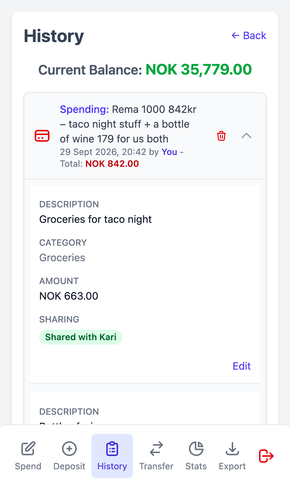

# Mobile PWA for budgeting, with LLM categorization

<p align="center">
  
</p>

## Cloudflare

Production runs as a Cloudflare Worker (`worker/`): a TypeScript port of the Go
API on Hono and D1, serving the built frontend as static assets. AI
categorisation jobs go through the `sapp-categorize` queue.

```sh
cd worker
npm ci
npm test
npm run deploy   # builds the frontend, applies D1 migrations, deploys
```

Secrets: `wrangler secret put JWT_SECRET_KEY` and `OPENROUTER_KEY`. The LLM
model is the `OPENROUTER_MODEL` var in `worker/wrangler.jsonc`.
`worker/scripts/sqlite-to-d1.py` converts the Go backend's SQLite file into a
D1 import (used once for the migration).
